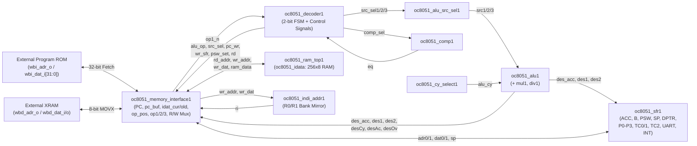

# WBS 1.1 / D01 — Arsitektur & Hierarki RTL Core 8051 (`oc8051`)

**Dokumen Referensi:** `rtl_reference/rtl/verilog/oc8051_top.v`  
**Repositori:** `https://github.com/freecores/8051.git`  
**Commit Hash (Locked):** `f1a1ce31640c3e5c67935b649235e644462365a5` (2003-07-15)  
**Lisensi:** GNU Lesser General Public License v2.1 or later (`LGPL-2.1-or-later`)

---

## 1. Ringkasan Top-Level & Clock / Reset

Core **`oc8051_top`** adalah mikrokontroler kompatibel 8051 berarsitektur **pipelined multi-cycle** (2–5 clock per instruksi) dengan antarmuka memori program dan memori data eksternal bergaya Wishbone/pipelined (`wbi_*` dan `wbd_*`).

| Aspek | Spesifikasi di `oc8051_top.v` | Implikasi untuk Testbench & Verifikasi |
| :--- | :--- | :--- |
| **Clock Utama** | `wb_clk_i` (rising edge `posedge`) | Semua FF di CPU, RAM, SFR, Timer, UART, dan Interrupt bekerja pada `posedge wb_clk_i`. |
| **Reset Utama** | `wb_rst_i` (**Active-High Asynchronous**) | Seluruh `always @(posedge clk or posedge rst)` me-reset saat `wb_rst_i == 1'b1`. Nilai reset: `PC=0000h`, `ACC=00h`, `B=00h`, `PSW=00h`, `SP=07h`, `DPTR=0000h`, `P0..P3=FFh`. |
| **Program Fetch Mode** | `ea_in` (`0` = Eksternal `wbi_*`, `1` = Internal ROM) | Di Day-1 TB (`tb/tb_8051_day1.v`), `ea_in = 1'b0` dan `OC8051_ROM` dimatikan agar CPU membaca instruksi langsung dari model ROM eksternal 32-bit `wbi_dat_i`. |
| **Internal RAM (256B)** | `oc8051_ram_top1` → `oc8051_ram_256x8_two_bist` | `tb/oc8051_defines.v` menonaktifkan `OC8051_RAM_GENERIC` sehingga memakai array behavioral internal `buff[0:256]` (tanpa ketergantungan eksternal `generic_dpram`). |

---

## 2. Daftar Port Top-Level (`oc8051_top`)

| Grup | Port | Arah | Lebar | Fungsi |
| :--- | :--- | :--- |---:| :--- |
| **Sys** | `wb_clk_i`, `wb_rst_i` | `input` | 1 | Clock sistem & reset asinkron active-high |
| **ROM (Code)** | `wbi_adr_o` | `output` | 16 | Alamat fetch instruksi / `MOVC` ke program ROM eksternal |
| | `wbi_dat_i` | `input` | 32 | Data 4-byte packed `{byte[a+3], byte[a+2], byte[a+1], byte[a]}` |
| | `wbi_stb_o`, `wbi_cyc_o` | `output` | 1 | Strobe & cycle bus instruksi (mode pipelined: selalu `1'b1`) |
| | `wbi_ack_i`, `wbi_err_i` | `input` | 1 | Acknowledge & error dari program ROM eksternal |
| **XRAM (Data)** | `wbd_adr_o`, `wbd_dat_o`, `wbd_dat_i` | `out/in` | 16 / 8 | Alamat & data 8-bit untuk `MOVX` external data RAM |
| | `wbd_we_o`, `wbd_stb_o`, `wbd_cyc_o` | `output` | 1 | Write enable, strobe, dan cycle bus data eksternal |
| | `wbd_ack_i`, `wbd_err_i` | `input` | 1 | Acknowledge & error dari XRAM eksternal |
| **Boot / Mode** | `ea_in` | `input` | 1 | External Access (`0` = fetch eksternal, `1` = internal ROM bila aktif) |
| **GPIO Ports** | `p0_i/p0_o`, `p1_i/p1_o`, `p2_i/p2_o`, `p3_i/p3_o` | `in/out` | 8 | 4 port I/O 8-bit (`OC8051_PORTS` & `OC8051_PORT0..3` aktif) |
| **Timer/Cnt** | `t0_i`, `t1_i`, `t2_i`, `t2ex_i` | `input` | 1 | Input counter/capture eksternal untuk Timer 0, 1, 2 |
| **UART** | `rxd_i`, `txd_o` | `in/out` | 1 | Pin serial RX/TX |
| **Interrupt** | `int0_i`, `int1_i` | `input` | 1 | External interrupt input (aktif jika diaktifkan di `IE`/`TCON`) |

---

## 3. Diagram Blok Hierarki (`oc8051_top`)

---

## 4. Hierarki Modul Lengkap (`rtl_reference/rtl/verilog/`)

| Instans di `oc8051_top` | File Verilog | Peran Fungsional |
| :--- | :--- | :--- |
| `oc8051_decoder1` | `oc8051_decoder.v` | FSM 2-bit (`state`), decode opcode `op_cur` menjadi kontrol ALU, RAM/SFR, PC, dan branch |
| `oc8051_memory_interface1` | `oc8051_memory_interface.v` | Fetch 32-bit ROM, buffer `idat_old`/`idat_cur`, `op_pos`, register `pc` & `pc_buf`, mux alamat RAM/SFR, handler XRAM/IRQ |
| `oc8051_alu_src_sel1` | `oc8051_alu_src_sel.v` | Mux operand `src1`, `src2`, `src3` dari ACC, RAM, operand `op1..3`, PC, atau DPTR |
| `oc8051_alu1` | `oc8051_alu.v` | Aritmetika & logika 8-bit, adder/subtractor berjenjang (`desCy/desAc/desOv`), memanggil `oc8051_multiply` & `oc8051_divide` |
| `oc8051_cy_select1` | `oc8051_cy_select.v` | Memilih carry input ALU (`0`, `PSW.CY`, `bit_out`, `1`) |
| `oc8051_comp1` | `oc8051_comp.v` | Pembanding cepat (`eq`) untuk instruksi jump kondisional (`DJNZ`, `JZ`, `JNZ`, `JC`, `JNC`, `CJNE`, `JB`) |
| `oc8051_ram_top1` | `oc8051_ram_top.v` + `oc8051_ram_256x8_two_bist.v` | Internal DATA/IDATA RAM 256 byte dengan akses byte maupun bit-addressable (`20h–2Fh`) |
| `oc8051_indi_addr1` | `oc8051_indi_addr.v` | Mirror register `R0` & `R1` (4 bank) agar indirect addressing `@Ri` tersedia tanpa extra RAM read |
| `oc8051_sfr1` | `oc8051_sfr.v` | Router & hub seluruh Special Function Registers (`80h–FFh`) + hazard detector `wait_data` / `comp_wait` |
| ↳ `oc8051_acc1` | `oc8051_acc.v` | Accumulator (`E0h`) + generator parity `p = ^acc` |
| ↳ `oc8051_b_register` | `oc8051_b_register.v` | Register B (`F0h`) |
| ↳ `oc8051_psw1` | `oc8051_psw.v` | Program Status Word (`D0h`: `CY, AC, F0, RS1, RS0, OV, -, P`) + `bank_sel` |
| ↳ `oc8051_sp1` | `oc8051_sp.v` | Stack Pointer (`81h`, reset `07h`, pre-increment push / post-decrement pop) |
| ↳ `oc8051_dptr1` | `oc8051_dptr.v` | Data Pointer 16-bit (`DPL=82h`, `DPH=83h`) |
| ↳ `oc8051_ports1` | `oc8051_ports.v` | Port I/O latches `P0..P3` (`80h, 90h, A0h, B0h`) + dukungan read-modify-write (`rmw`) |
| ↳ `oc8051_tc1`, `oc8051_tc21` | `oc8051_tc.v`, `oc8051_tc2.v` | Timer/Counter 0, 1, dan 2 (native — siap untuk WBS Hari 2) |
| ↳ `oc8051_uatr1` | `oc8051_uart.v` | Serial UART (`SCON`, `SBUF`, `PCON`) (native) |
| ↳ `oc8051_int1` | `oc8051_int.v` | Interrupt controller 2-level (`IE`, `IP`, `TCON`, `int_src`, `intr`) (native — siap untuk WBS Hari 2) |

---

## 5. Status Kesiapan Peripheral (P-01 / P-04)

Semua peripheral inti yang dibutuhkan untuk **Hari 1 dan Hari 2** (`GPIO P0–P3`, `Timer 0/1/2`, `UART`, `Interrupt Controller`) **tersedia secara native** di dalam `freecores/8051`. Tidak diperlukan model peripheral pendidikan pengganti (fallback stub).
