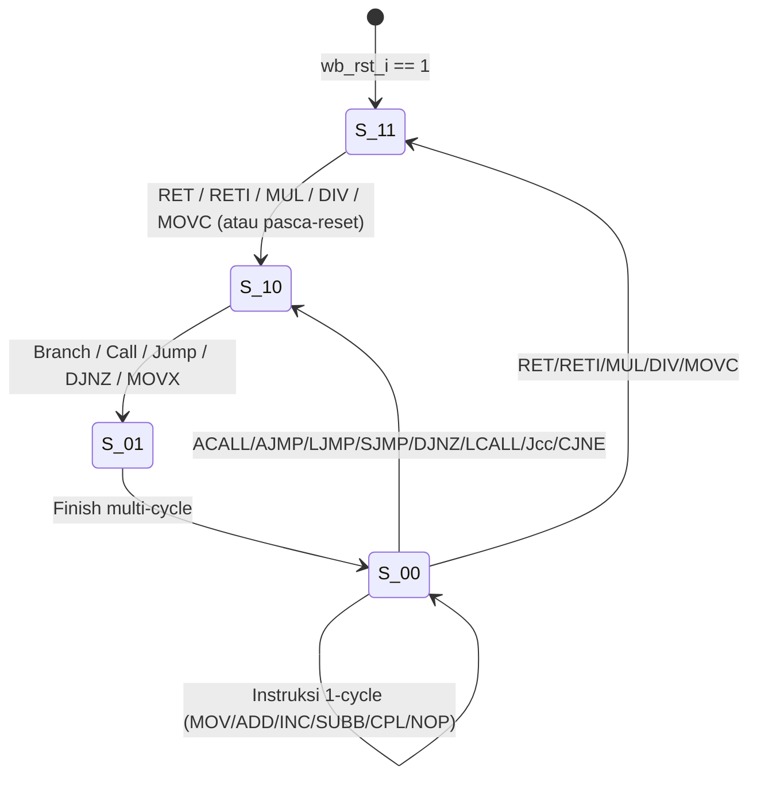

# WBS 1.5 / E03 — Decode FSM, Branch Update & Program Firmware (`.asm` / `.hex`)

**Sumber RTL:** `oc8051_decoder.v` (`lines 2638–2682`), `oc8051_memory_interface.v` (`lines 912–968`), `oc8051_comp.v`  
**Bukti Simulasi:** `reports/test_b_trace.csv`, `reports/test_b_trace_check.md`

---

## 1. FSM 2-Bit `oc8051_decoder1.state` & Update PC

Pada `oc8051_decoder.v`, register `state[1:0]` mengatur instruksi single-cycle vs multi-cycle (`rd = !state[0] && !state[1] && !wait_data`):

### Bagaimana Target Branch Dihitung (`oc8051_memory_interface.v`):
1. **`DJNZ R2, rel` & `SJMP rel`:**
   - Saat `state == 2'b10`, decoder mengaktifkan `pc_sel = OC8051_PIS_SO1` (`2'b010`) dengan kondisi `pc_wr = !eq` (`DJNZ`) atau `pc_wr = 1` (`SJMP`).
   - Adder signed relative `pcs_result` menambahkan `op2_out` (signed 8-bit `FCh = -4` untuk `DJNZ`, `02h = +2` untuk `SJMP`) ke `pc`.
   - `pc_wr_r` → `pc_wr_r2` men-stall `mem_wait` sebentar agar `op_pos` diset ulang ke `4` (`pc_buf` baru) dan prefetch ROM dari alamat target berjalan bersih.
2. **`LCALL addr16` (`12 00 20`) & `RET` (`22`):**
   - `LCALL`: `state` bergerak `00 → 10 → 01 → 00`; mendorong `PC+3` (`0011h`) ke `RAM[08h]=11h, RAM[09h]=00h`, memuat `pc_buf <= {op2_out, op3_out}` (`0020h`, `PIS_I16`).
   - `RET`: `state` bergerak `00 → 11 → 10 → 01 → 00`; membaca `RAM[09h]` ke `pc_buf[15:8]` (`PIS_AH`) lalu `RAM[08h]` ke `pc_buf[7:0]` (`PIS_AL`) dan mengembalikan `SP = 07h`.

---

## 2. Daftar 3 Program Firmware Assembly & HEX (`firmware/asm/`)

| Program | File `.asm` / `.hex` / `.in` | SHA-256 (`.hex`) | Cakupan Instruksi & Uji |
|---|---|---|---|
| **1. Smoke Baseline (P-02)** | `hello.{asm,hex,in}` | `34e491387bcfbd466b66568391ef7120d4d05e5107a9276179ed8678798adecf` | `MOV A,#55h`, `MOV P0,A`, `CPL A`, `MOV 30h,A`, `MOV P1,#7Fh`, `SJMP` |
| **2. Test A Aritmetika (E01/E02)** | `test_a_arith.{asm,hex,in}` | `bca581539d13aaa778c86d99481c1b752403c4adfe4d34e000ca71ebffb0ed5e` | `MOV A,#05h`, `ADD A,#03h`, `MOV 30h,A`, `INC A`, `SUBB A,#02h`, `ADD A,#0FCh`, `MOV 34h,PSW` |
| **3. Test B Control & Stack (E03/E04)** | `test_b_ctrl_stack.{asm,hex,in}` | `df950dc004f1cb656ffaa96efef29c2dbbe9f94bb7a80b56f122bf881798c5cf` | `MOV R2,#04h`, `ADD A,#03h`, `DJNZ R2,loop_sum`, `SJMP` (lewati `trap`), `LCALL`, `RET`, `MOV R0,#40h`, `MOV @R0,A` |

---

## 3. Bukti Trace Loop `DJNZ` 4 Iterasi & Branch `SJMP` (`test_b_trace.csv`)

| Iterasi | Decode Cyc (`ADD`) | Decode Cyc (`DJNZ`) | `R2` (sebelum → sesudah) | `ACC` (sesudah `ADD`) | Target `PC` berikutnya |
|---:|---:|---:|:---:|:---:|:---:|
| 1 | 14 | 15 | `04h → 03h` (`eq=0`, branch taken) | `03h` | `0004h` (`loop_sum`) |
| 2 | 19 | 20 | `03h → 02h` (`eq=0`, branch taken) | `06h` | `0004h` (`loop_sum`) |
| 3 | 24 | 25 | `02h → 01h` (`eq=0`, branch taken) | `09h` | `0004h` (`loop_sum`) |
| 4 | 29 | 30 | `01h → 00h` (`eq=1`, fall-through) | `0Ch` | `0008h` (`MOV 30h, A`) |

- Setelah `MOV 30h, A` (`RAM[30h] = 0Ch`) di Cycle 33, `SJMP after_trap` (`80 02` di `000Ah`) melompat langsung ke `000Eh` (`LCALL add_ten`), melewati instruksi jebakan `000Ch: MOV A, #0FFh` — terbukti dari `ACC` tetap `0Ch` (tidak pernah berubah menjadi `FFh`).

**Verdict E03 (DJNZ / Branch):** `PASS` — Tepat 4 iterasi (`0Ch = 4 × 3`), `R2 = 00h`, dan target PC `DJNZ`/`SJMP` cocok 100% dengan golden ISA model.
